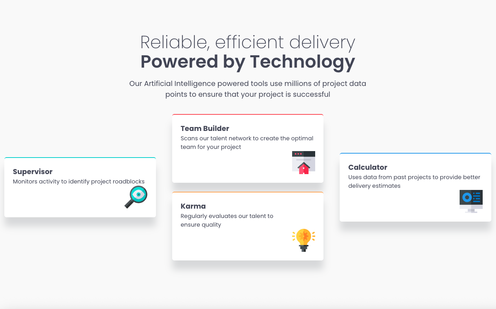

# Frontend Mentor - Four card feature section solution

This is a solution to the [Four card feature section challenge on Frontend Mentor](https://www.frontendmentor.io/challenges/four-card-feature-section-weK1eFYK). Frontend Mentor challenges help you improve your coding skills by building realistic projects.

## Table of contents

- [Overview](#overview)
  - [The challenge](#the-challenge)
  - [Screenshot](#screenshot)
  - [Links](#links)
- [My process](#my-process)
  - [Built with](#built-with)
  - [Useful resources](#useful-resources)

## Overview

### The challenge

Users should be able to:

- View the optimal layout for the site depending on their device's screen size

### Screenshot



### Links

- Solution URL: [GitHub repo](https://github.com/JammiM/four-card-feature-section-fem)
- Live Site URL: [live site](https://jammim.github.io/four-card-feature-section-fem/)

---

### Built with

- Semantic HTML5 markup
- CSS custom properties
- Flexbox
- SASS
- Mobile-first workflow

---

### Useful resources

- [An Interactive Guide to Flexbox](https://www.joshwcomeau.com/css/interactive-guide-to-flexbox/) - This helped me for a Flexbox reference.
- [flex CSS property](https://developer.mozilla.org/en-US/docs/Web/CSS/Reference/Properties/flex) - I found the

```css
flex: 1;
```

property very useful for equal grid sizes.

- [google-webfonts-helper](https://gwfh.mranftl.com/fonts) - Incredibly useful for using google fonts, with the woff2 format

---

## Acknowledgments

Thanks to [Elmar Chavez](https://www.frontendmentor.io/profile/CodingWithJiro) for his amazing advice, on to improve my work, it's greatly appreciated
